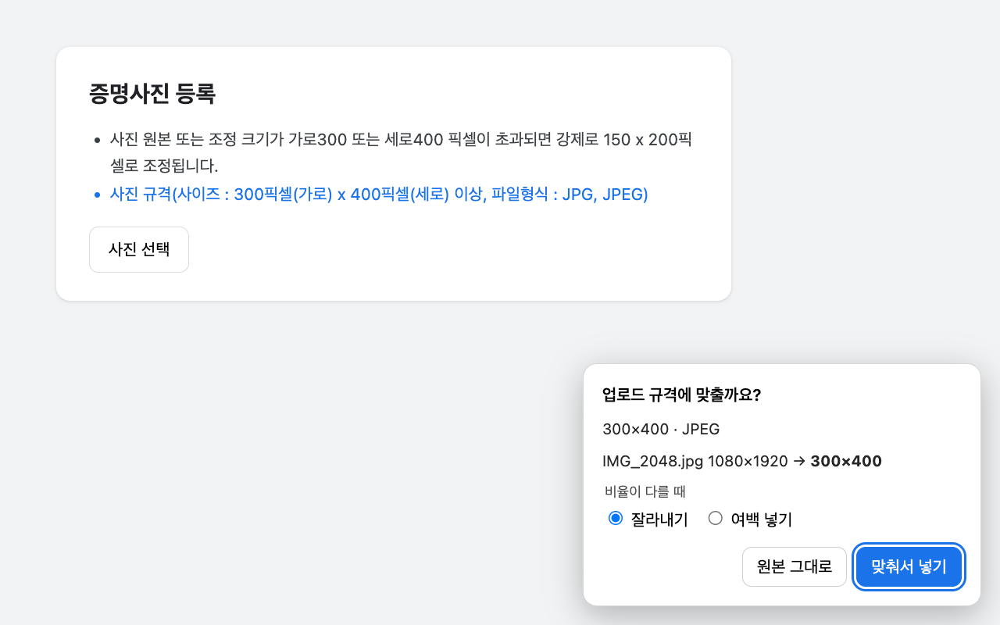

# upload-fit

업로드 칸 옆에 적힌 안내문(크기·용량·형식)을 읽고, 고른 사진을 **그 규격에 맞게 바꿔서** 넣어주는 Chrome 확장.

"300×400 픽셀 이상, 200KB 이하, JPG만" 같은 규격 때문에 사진 편집 사이트를 따로 찾아다닐 필요가 없다.
규격을 직접 입력하는 기존 도구와 달리, **페이지에 적힌 문구를 읽어서 알아서** 맞춘다.

## 이런 곳에서 쓴다
규격이 틀리면 **거부만 하고 고쳐주지 않는 곳**.

- Google Play Console — 스크린샷·앱 아이콘·그래픽 이미지
- Q-Net·국가고시·여권·운전면허 등 증명사진 등록
- 그 밖에 업로드 칸 근처에 "○○px", "○○KB 이하", "JPG만" 같은 문구가 있는 곳

자체 자르기 도구가 있는 곳(사람인 등)이나 규격 문구가 없는 곳에서는 아무것도 하지 않는다.

## 설치
1. [Releases](../../releases)에서 `upload-fit-<버전>.zip`을 받아 압축을 푼다.
2. Chrome 주소창에 `chrome://extensions` → 오른쪽 위 **개발자 모드** 켜기.
3. **압축해제된 확장 프로그램을 로드합니다** → 압축 푼 폴더 선택.

업데이트: 새 zip을 같은 폴더에 덮어 풀고, `chrome://extensions`의 upload-fit 카드에서 새로고침(↻).

## 쓰는 법
평소처럼 업로드 버튼을 누르고 사진을 고르면 된다.

- 맞출 게 있으면 오른쪽 아래에 카드가 뜬다 → **맞춰서 넣기**
  - 비율이 다르면 **잘라내기**(가운데 기준) 또는 **여백 넣기**(흰 여백) 중 고른다.
- **원본 그대로** 또는 Esc → 원본이 그대로 들어간다.
- 이미 규격에 맞거나, 규격 문구를 못 찾으면 카드 없이 원본이 들어간다.
- 무엇이 잘못되든 원본은 반드시 들어간다.

## 개인정보
**사진과 페이지 내용은 브라우저 밖으로 나가지 않는다.**
네트워크 요청·저장소·분석 도구를 쓰지 않는다. 페이지 글자는 규격 문구를 찾을 때만 읽고 그 자리에서 버린다.
→ [개인정보처리방침](PRIVACY.md)

## 안 되는 것
- 파일을 끌어다 놓는(드래그앤드롭) 업로드 — 파일 선택창으로 고를 때만 동작
- HEIC 사진 (Chrome이 못 읽음) — 원본 그대로 들어간다
- 일부 사이트의 팝업 창은 카드를 누를 때 같이 닫힐 수 있다 → "업로드 칸이 닫혀서…" 안내가 뜨면 다시 고르면 된다
- 약관처럼 아주 긴 페이지 안의 업로드 칸 (엉뚱한 문구를 규격으로 읽지 않으려고 일부러 찾지 않는다)

## 개발
- 테스트: `node --test` (Node 24 + Chrome). 실제 사이트 안내문 원문으로 만든 테스트와 headless Chrome 브라우저 테스트가 같이 돈다.
- 배포용 zip: `./pack.sh` → `dist/`
- 구조·규칙: [CLAUDE.md](CLAUDE.md), 설계와 확인된 사실: [docs/design.md](docs/design.md)
